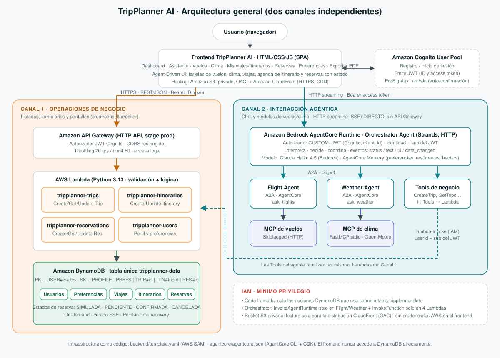

# TripPlanner AI · Your AI Travel Companion

Trabajo final de **Programación Agéntica**: TripPlanner pasa del Playground de AgentCore a una **plataforma web**
para planificar y gestionar viajes, sobre una arquitectura distribuida en AWS.

- **Multiagente (se conservan los 3 agentes):** Orchestrator Agent (HTTP streaming) → Flight Agent (A2A, MCP de vuelos)
  y Weather Agent (A2A, MCP de clima), construidos con Strands Agents y desplegados en Amazon Bedrock AgentCore.
- **Nuevas Tools de negocio:** CreateTrip, GetTrips, UpdateTrip, CreateItinerary, UpdateItinerary, CreateReservation,
  GetReservations, UpdateReservation (+ detalle de viaje y preferencias), cada una respaldada por AWS Lambda → DynamoDB.
- **Backend serverless (AWS SAM):** API Gateway (JWT Cognito, CORS, throttling) + Lambda + DynamoDB.
- **Frontend:** SPA HTML/CSS/JS en S3 + CloudFront con 6 módulos (Dashboard, Asistente, Vuelos, Clima, Mis viajes e
  itinerarios, Reservas) + Preferencias, Agent-Driven UI y **exportación PDF** (funcionalidad opcional).



## Despliegue actual (us-east-2)

| Componente | Recurso |
|---|---|
| Frontend (CloudFront) | https://d3vmzvubx89wb6.cloudfront.net |
| API Gateway | https://ci97awf0j6.execute-api.us-east-2.amazonaws.com/prod |
| Orchestrator (AgentCore) | `tripplaner_OrchestratorAgent-Cj0BQ6H0du` (HTTP, CUSTOM_JWT) |
| Flight / Weather Agent | `tripplaner_FlightsAgent-0gk2C36EvR` / `tripplaner_WeatherAgent-6TkRXe30Aa` (A2A) |
| DynamoDB | `tripplanner-data` |
| Stacks | `tripplanner-backend` (SAM) · `AgentCore-tripplaner-final` (AgentCore CDK) |

## Estructura

```
backend/                 Backend serverless (AWS SAM)
  template.yaml          DynamoDB, Cognito, Lambdas, HTTP API, S3 + CloudFront, IAM
  src/                   Lambdas: trips, itineraries, reservations, users, presignup + common
app/
  OrchestratorAgent/     Orchestrator (HTTP): main.py, business_tools.py (Tools→Lambda), ui_events.py (SSE/UI)
  FlightsAgent/          Flight Agent (A2A) + MCP de vuelos (Skiplagged)
  WeatherAgent/          Weather Agent (A2A) + weather_mcp_server.py (MCP de clima, Open-Meteo)
agentcore/               Configuración AgentCore (agentcore.json, aws-targets.json, CDK)
frontend/                SPA: index.html, css/, js/ (auth, api, agent, components, pdf, app)
docs/                    DOCUMENTACION_TECNICA.md y arquitectura.svg
scripts/                 deploy_frontend.sh, serve.mjs (servidor local)
tests/                   Pruebas unitarias (pytest) y backend_smoke.mjs (pruebas del API desplegado)
```

## Despliegue rápido

```bash
cd backend && sam deploy && cd ..                 # 1. backend serverless
agentcore deploy --target final -y                # 2. agentes en AgentCore
bash scripts/deploy_frontend.sh                   # 3. frontend en S3 + CloudFront
node tests/backend_smoke.mjs                      # 4. verificación del canal 1
```

Detalle completo (modelo de datos, APIs, Lambdas, Tools, integración de agentes, seguridad y pasos desde cero):
**[docs/DOCUMENTACION_TECNICA.md](docs/DOCUMENTACION_TECNICA.md)**.

## Escenario de demostración

> “Quiero organizar unas vacaciones de cuatro días en Cartagena. Salgo desde Bogotá, viajo con dos personas más y
> tengo un presupuesto de 5 millones de pesos. Quiero conocer el clima, encontrar vuelos y organizar algunas
> actividades turísticas”.

1. Ingresar al frontend (CloudFront) e iniciar sesión.
2. Asistente → enviar la solicitud (botón *Planificar con IA*). Se ven en vivo el Orchestrator, Flight Agent y Weather Agent.
3. El frontend presenta tarjetas comparativas de vuelos (ida y regreso) y tarjetas de clima por día.
4. “Crea el viaje con ese plan y genera el itinerario” → CreateTrip + CreateItinerary (agenda por día).
5. “Reserva el vuelo de ida más barato” → CreateReservation (estado **Simulada**).
6. Salir, volver a entrar: Dashboard, Mis viajes y Reservas muestran los datos persistidos en DynamoDB.
7. Mis viajes → detalle → **Exportar PDF**.

## Pruebas

```bash
pytest tests                 # 43 pruebas unitarias de agentes, MCP de clima, parsing y Tools
node tests/backend_smoke.mjs # 15 verificaciones contra el API desplegado (auth, validación, aislamiento, pagos)
```
