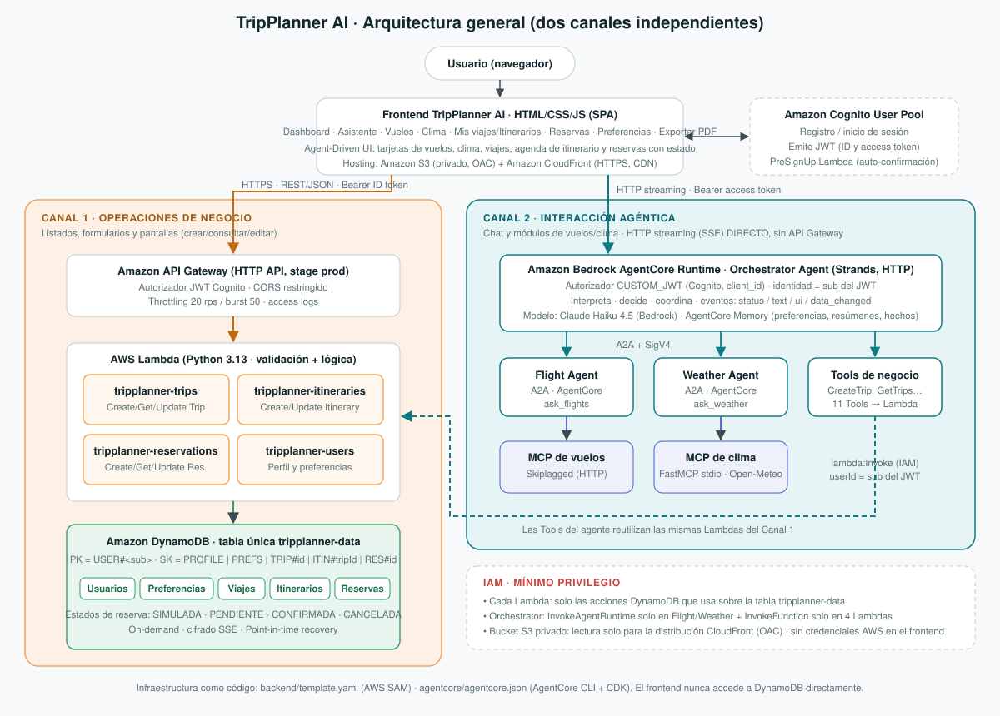

# TripPlanner AI · Documentación técnica

Trabajo final · Programación Agéntica · Ingeniería de Sistemas

TripPlanner evoluciona de una demo de agentes en el Playground de AgentCore a una **aplicación web completa**:
frontend publicado en S3 + CloudFront, backend serverless (API Gateway + Lambda + DynamoDB) y la arquitectura
multiagente existente (Orchestrator, Flight Agent y Weather Agent) desplegada en Amazon Bedrock AgentCore.

---

## 1. Arquitectura



### 1.1 Dos canales independientes

| Canal | Flujo | Uso |
|---|---|---|
| **1 · Operaciones de negocio** | Frontend → API Gateway (JWT Cognito) → Lambda → DynamoDB | Listados, formularios y pantallas: crear/consultar/editar viajes, itinerarios, reservas y preferencias. |
| **2 · Interacción agéntica** | Frontend → **HTTP streaming directo** → AgentCore Runtime → Orchestrator Agent | Chat y módulos de vuelos/clima. El Orchestrator delega en Flight Agent (MCP de vuelos), Weather Agent (MCP de clima) y en las Tools de negocio (Lambdas). |

El canal 2 **no pasa por API Gateway**: el navegador invoca
`https://bedrock-agentcore.us-east-2.amazonaws.com/runtimes/<ARN>/invocations` con el *access token* de Cognito;
AgentCore lo valida con su autorizador `CUSTOM_JWT` (discovery URL del User Pool + `allowedClients`). El endpoint de
AgentCore responde CORS (`Access-Control-Allow-Origin: *`), así que no se requiere proxy.

### 1.2 Componentes

| Componente | Recurso | Responsabilidad |
|---|---|---|
| Frontend | `frontend/` (HTML/CSS/JS, sin build) en S3 privado + CloudFront (OAC, HTTPS, cabeceras de seguridad) | Experiencia de usuario, Agent-Driven UI, exportación PDF. |
| Autenticación | Cognito User Pool `tripplanner-users` + cliente público `tripplanner-web` | Registro e inicio de sesión; emite los JWT que protegen ambos canales. |
| API Gateway | HTTP API `prod` | Expone las operaciones de negocio: autorizador JWT, CORS restringido, throttling y access logs. |
| Lambda | `tripplanner-trips`, `-itineraries`, `-reservations`, `-users`, `-presignup` | Lógica de negocio y validaciones. Atienden tanto API Gateway como las Tools del agente. |
| DynamoDB | Tabla única `tripplanner-data` | Persistencia (fuente de verdad del negocio). |
| AgentCore Runtime | `tripplaner_OrchestratorAgent` (HTTP), `tripplaner_FlightsAgent` (A2A), `tripplaner_WeatherAgent` (A2A) | Ejecución y exposición por HTTP streaming de los agentes Strands. |
| AgentCore Memory | `TripPlannerMemory` (USER_PREFERENCE, SUMMARIZATION, SEMANTIC) | Memoria conversacional de los agentes. |
| MCP | Skiplagged (vuelos, HTTP) · `weather_mcp_server.py` (clima, FastMCP stdio sobre Open-Meteo) | Herramientas especializadas. |
| IAM | Roles por Lambda y por runtime | Mínimo privilegio. |

### 1.3 Decisiones de diseño

1. **Se conservan los tres agentes.** El Orchestrator sigue delegando por A2A en Flight y Weather; se le agregaron 11
   Tools de negocio. No hay lógica en el frontend que simule agentes: el frontend solo renderiza los datos que emite el agente.
2. **Agent-Driven UI por eventos.** El Orchestrator emite por SSE eventos tipados además del texto:
   `status` (indicador de procesamiento), `tool` (qué agente/Tool está activo), `text` (deltas del modelo),
   `ui` (bloque estructurado: `flights`, `weather`, `trip`, `trips`, `itinerary`, `reservation`, `reservations`,
   `preferences`), `data_changed` (el frontend refresca listados), `error` y `done`.
   Las Tools publican los bloques en una cola `asyncio` por petición (`ui_events.py`), de modo que el usuario ve
   el estado en tiempo real mientras los especialistas trabajan.
3. **Resultados autoritativos.** Flight y Weather Agent devuelven la salida de su herramienta tal cual
   (`FlightResponseAgent`, `WeatherResponseAgent`) para que el LLM no altere precios ni temperaturas. El Weather Agent
   devuelve JSON; el Orchestrator convierte las filas de vuelos en objetos (`parse_flights`).
4. **Las Tools reutilizan las Lambdas del canal 1.** Una única implementación de negocio y validación. La Lambda
   distingue el origen: evento de API Gateway (usuario = claim `sub` del JWT) o invocación directa
   `{"source":"agent-tool","action","userId","params"}` (usuario = `sub` del JWT validado por AgentCore, tomado del
   header `Authorization` en el runtime; el modelo **nunca** decide el `userId`).
5. **Tabla única en DynamoDB.** Todas las entidades de un usuario comparten partición (`PK = USER#<sub>`), lo que
   garantiza aislamiento por usuario y consultas por prefijo de `SK` sin escaneos.
6. **MCP de clima propio.** El Weather Agent original usaba un pronóstico simulado y no tenía MCP. Se agregó un servidor
   MCP (FastMCP, transporte stdio) que consulta Open-Meteo (gratis, sin API key): temperatura máx/mín, condición,
   probabilidad de lluvia y precipitación. Fuera del horizonte de 16 días usa el histórico del año anterior y lo marca
   como estimado.
7. **Modelo del Orchestrator.** Se cambió de Nova Lite a Claude Haiku 4.5 (`us.anthropic.claude-haiku-4-5-20251001-v1:0`)
   por su fiabilidad generando argumentos estructurados (itinerarios por día) en llamadas a Tools. Los especialistas
   siguen en Nova Lite.
8. **Memoria ≠ persistencia.** AgentCore Memory ayuda a conversar (contexto por sesión, preferencias y hechos por
   actor = `sub`). Viajes, itinerarios y reservas viven en DynamoDB.

---

## 2. Modelo de datos (DynamoDB)

Tabla `tripplanner-data` · On-demand · SSE · PITR · `PK` (HASH, S) + `SK` (RANGE, S).

| Entidad | PK | SK | Atributos principales |
|---|---|---|---|
| Usuario | `USER#<sub>` | `PROFILE` | `userId`, `email`, `name`, `homeCity`, `createdAt` |
| Preferencias | `USER#<sub>` | `PREFS` | `budgetLevel` (ECONOMICO/MEDIO/ALTO/LUJO), `activityTypes[]`, `preferredAirlines[]`, `dietaryRestrictions[]`, `seat`, `preferredDepartureTime`, `homeCity`, `notes` |
| Viaje | `USER#<sub>` | `TRIP#<tripId>` | `tripId`, `title`, `origin`, `destination`, `startDate`, `endDate`, `travelers`, `budget`, `currency`, `preferences[]`, `notes`, `status` |
| Itinerario | `USER#<sub>` | `ITIN#<tripId>` | `tripId`, `destination`, `days[] = {day, date, title, activities[] = {time, title, description, location, category, estimatedCost}}`, `notes` |
| Reserva | `USER#<sub>` | `RES#<reservationId>` | `reservationId`, `tripId`, `tripTitle`, `type` (FLIGHT/HOTEL/ACTIVITY), `title`, `provider`, `date`, `time`, `endDate`, `location`, `details`, `quantity`, `price`, `currency`, `status`, `simulated`, `confirmationCode` |

Todos los ítems tienen `entityType`, `createdAt` y `updatedAt` (ISO-8601 UTC).

**Estados**
- Viaje: `PLANIFICADO`, `CONFIRMADO`, `EN_CURSO`, `COMPLETADO`, `CANCELADO`.
- Reserva: `SIMULADA` (por defecto, registrada sin proveedor externo), `PENDIENTE`, `CONFIRMADA` (solo proveedor real:
  la API la rechaza porque no se integra proveedor), `CANCELADA`. Código de confirmación `SIM-XXXXXX`.

**Patrones de acceso**

| Patrón | Operación |
|---|---|
| Perfil / preferencias | `GetItem(PK, SK=PROFILE|PREFS)` |
| Listar viajes del usuario | `Query(PK, begins_with(SK,"TRIP#"))` |
| Detalle de viaje | `GetItem(TRIP#id)` + `GetItem(ITIN#id)` + `Query(RES#)` filtrando `tripId` |
| Itinerario de un viaje | `GetItem(PK, SK=ITIN#tripId)` |
| Reservas del usuario (filtros estado/tipo/viaje) | `Query(PK, begins_with(SK,"RES#"))` + filtro en Lambda |
| Actualizar reserva | `UpdateItem(PK, RES#id)` con `ConditionExpression attribute_exists(SK)` |
| Eliminar viaje | `BatchWriteItem` del viaje, su itinerario y sus reservas |

Justificación: el volumen por usuario es pequeño (decenas de ítems), todas las lecturas están acotadas a la partición
del usuario y el aislamiento por usuario queda garantizado por la clave.

---

## 3. APIs (API Gateway HTTP API)

Base: `https://<api-id>.execute-api.us-east-2.amazonaws.com/prod` · Header `Authorization: Bearer <JWT Cognito>` obligatorio
en todas las rutas (sin token → `401`). CORS: origen de CloudFront y `http://localhost:5173`. Throttling: 20 rps, ráfaga 50.

| Método | Ruta | Lambda / acción | Cuerpo / parámetros | Respuesta |
|---|---|---|---|---|
| GET | `/me` | users · `get_profile` | — | `200 {profile, preferences}` (crea el perfil la primera vez) |
| PUT | `/me` | users · `update_profile` | `{name, homeCity?}` | `200 profile` |
| GET | `/preferences` | users · `get_preferences` | — | `200 preferences` |
| PUT | `/preferences` | users · `update_preferences` | campos de preferencias (fusiona) | `200 preferences` |
| POST | `/trips` | trips · `create_trip` | `{destination*, startDate*, endDate*, origin, travelers, budget, currency, title, preferences[], notes}` | `201 trip` |
| GET | `/trips` | trips · `get_trips` | `?status=` | `200 {trips[], count}` |
| GET | `/trips/{tripId}` | trips · `get_trip` | — | `200 {trip, itinerary, reservations[]}` |
| PUT | `/trips/{tripId}` | trips · `update_trip` | campos a cambiar | `200 trip` |
| DELETE | `/trips/{tripId}` | trips · `delete_trip` | — | `200 {deleted}` |
| POST | `/trips/{tripId}/itinerary` | itineraries · `create_itinerary` | `{days[]*, notes, replace?}` | `201 itinerary` |
| PUT | `/trips/{tripId}/itinerary` | itineraries · `update_itinerary` | `{days[]}` (completo) o `{day}` (un día) o `{notes}` | `200 itinerary` |
| GET | `/trips/{tripId}/itinerary` | itineraries · `get_itinerary` | — | `200 itinerary` |
| POST | `/reservations` | reservations · `create_reservation` | `{tripId*, type*, title*, date*, time, provider, location, details, price, currency, quantity, endDate, status}` | `201 reservation` |
| GET | `/reservations` | reservations · `get_reservations` | `?tripId=&status=&type=` | `200 {reservations[], count}` |
| PUT | `/reservations/{reservationId}` | reservations · `update_reservation` | campos a cambiar (incluye `status`, `tripId`) | `200 reservation` |

**Errores** (cuerpo `{"error": {"code", "message"}}`, sin detalles internos):

| Código | HTTP | Caso |
|---|---|---|
| `UNAUTHORIZED` | 401 | Token ausente o inválido |
| `VALIDATION_ERROR` | 400 | Tipos, rangos, fechas, estados no permitidos, datos de pago, `CONFIRMADA` sin proveedor |
| `NOT_FOUND` | 404 | El recurso no existe **para ese usuario** (también cuando pertenece a otro usuario) |
| `FORBIDDEN` | 403 | Invocación directa de Lambda sin `source=agent-tool` |
| — | 429 | Throttling de API Gateway |
| `INTERNAL_ERROR` | 500 | Error no controlado (se registra en CloudWatch, mensaje genérico al usuario) |

---

## 4. Lambdas

Código en `backend/src/`, módulo común `common.py` (despacho API/Tool, validación, errores, serialización).
Python 3.13 · arm64 · 256 MB · 15 s · X-Ray activo · logs JSON.

| Función | Handler | Acciones | Validaciones destacadas | Permisos IAM (sobre `tripplanner-data`) |
|---|---|---|---|---|
| `tripplanner-users` | `users.handler` | get/update profile, get/update preferences | enums de presupuesto/asiento/horario, listas ≤ 20, textos acotados | `GetItem`, `PutItem`, `UpdateItem` |
| `tripplanner-trips` | `trips.handler` | create/get/list/update/delete trip | fechas ISO, regreso ≥ salida, duración ≤ 60 días, viajeros 1–20, presupuesto ≥ 0, moneda permitida, estado permitido | `GetItem`, `PutItem`, `UpdateItem`, `DeleteItem`, `Query`, `BatchWriteItem` |
| `tripplanner-itineraries` | `itineraries.handler` | create/update/get itinerary | el viaje existe y es del usuario, nº de días ≤ duración, día dentro del rango, hora `HH:MM`, ≤ 15 actividades/día, categoría normalizada | `GetItem`, `PutItem` |
| `tripplanner-reservations` | `reservations.handler` | create/list/update reservation | tipo FLIGHT/HOTEL/ACTIVITY (acepta alias en español), fecha dentro del viaje, `CONFIRMADA` rechazada, hora `HH:MM` | `GetItem`, `PutItem`, `UpdateItem`, `Query` |
| `tripplanner-presignup` | `presignup.handler` | Trigger PreSignUp de Cognito | auto-confirma el registro (entorno académico, evita depender de SES) | ninguno |

Reglas transversales (`common.py`): rechazo de datos de pago (claves `cvv`, `card`, `tarjeta`… y números que pasan Luhn),
cuerpo ≤ 64 KB, `userId` con formato válido, códigos HTTP correctos y mensajes sin detalles internos.

---

## 5. Tools del Orchestrator

Archivo `app/OrchestratorAgent/business_tools.py`. Cada Tool invoca su Lambda con `lambda:InvokeFunction`
(payload `source=agent-tool`) y publica un bloque de UI.

| Tool | Parámetros | Lambda (acción) | Bloque UI |
|---|---|---|---|
| **CreateTrip** `create_trip` | destination, start_date, end_date, origin, travelers, budget, currency, title, preferences, notes | trips (`create_trip`) | `trip` |
| **GetTrips** `get_trips` | status | trips (`get_trips`) | `trips` |
| `get_trip_details` | trip_id | trips (`get_trip`) | `trip`, `itinerary`, `reservations` |
| **UpdateTrip** `update_trip` | trip_id + campos opcionales | trips (`update_trip`) | `trip` |
| **CreateItinerary** `create_itinerary` | trip_id, days[], notes | itineraries (`create_itinerary`) | `itinerary` |
| **UpdateItinerary** `update_itinerary` | trip_id, days[] \| day \| notes | itineraries (`update_itinerary`) | `itinerary` |
| **CreateReservation** `create_reservation` | trip_id, type, title, date, time, provider, location, details, price, currency, quantity, end_date, status | reservations (`create_reservation`) | `reservation` |
| **GetReservations** `get_reservations` | trip_id, status, type | reservations (`get_reservations`) | `reservations` |
| **UpdateReservation** `update_reservation` | reservation_id + campos opcionales | reservations (`update_reservation`) | `reservation` |
| `get_user_preferences` | — | users (`get_preferences`) | — |
| `save_user_preferences` | activity_types, budget_level, preferred_airlines, dietary_restrictions, seat, preferred_departure_time, home_city, notes | users (`update_preferences`) | `preferences` |

Delegación a especialistas (A2A firmado con SigV4 usando el rol del runtime):

| Tool | Especialista | Herramienta MCP | Bloque UI |
|---|---|---|---|
| `ask_flights(request)` | Flight Agent | `sk_resolve_iata`, `sk_flights_search` (MCP Skiplagged) | `flights` |
| `ask_weather(request)` | Weather Agent | `get_weather_forecast` (MCP de clima, Open-Meteo) | `weather` |

---

## 6. Integración de agentes

### 6.1 Frontend ↔ AgentCore (HTTP streaming)

```
POST https://bedrock-agentcore.us-east-2.amazonaws.com/runtimes/<ARN url-encoded>/invocations?qualifier=DEFAULT
Authorization: Bearer <access token Cognito>
X-Amzn-Bedrock-AgentCore-Runtime-Session-Id: tp-<uuid>      (≥ 33 caracteres, uno por conversación)
Content-Type: application/json
{"prompt": "Quiero organizar unas vacaciones…"}
```

La respuesta es `text/event-stream`; cada línea `data:` es un JSON con `type` (ver §1.3). `frontend/js/agent.js` lee el
stream con `ReadableStream` y la vista del asistente muestra: estado actual, chips de agentes/Tools activos, texto en
streaming y tarjetas. El `session id` se guarda por usuario para mantener el contexto entre recargas.

### 6.2 Orchestrator ↔ especialistas y Tools

1. AgentCore valida el JWT (`CUSTOM_JWT`) y reenvía el header `Authorization` (en `requestHeaderAllowlist`).
2. `main.py` decodifica el `sub` → `ContextVar current_user` (identidad de las Tools) y `actor_id` de la memoria.
3. El agente Strands (Claude Haiku 4.5) decide las herramientas; Strands ejecuta en paralelo `ask_flights` (ida),
   `ask_flights` (regreso) y `ask_weather`.
4. `ask_*` invoca el runtime A2A del especialista (`A2AAgent` + `httpx` firmado SigV4). Flight Agent usa el MCP de
   Skiplagged por HTTP; Weather Agent lanza su MCP de clima por stdio.
5. Las Tools de negocio invocan las Lambdas y publican eventos `ui` / `data_changed`.
6. `AgentCoreMemorySessionManager` persiste la conversación y extrae preferencias/hechos (`/preferences/{actorId}/`,
   `/facts/{actorId}/`, resúmenes por sesión).

---

## 7. Seguridad

| Requisito | Implementación |
|---|---|
| IAM mínimo privilegio | Políticas por Lambda limitadas a acciones concretas sobre la tabla; `app/OrchestratorAgent/iam-policy.json` limita al Orchestrator a invocar solo Flight/Weather y las 4 Lambdas; bucket privado con OAC. |
| Sin credenciales en el frontend | Solo identificadores públicos en `config.js` (región, URL de API, ClientId, ARN). Sin claves AWS. |
| Validación en Lambda | Tipos, rangos, fechas, estados y tamaños (§4). |
| Control de acceso por usuario | `PK = USER#<sub>` derivado del JWT; recurso ajeno → 404. Probado en `tests/backend_smoke.mjs`. |
| Protección de APIs | Autorizador JWT Cognito, CORS restringido, throttling, access logs. AgentCore con `CUSTOM_JWT`. |
| Manejo de errores | Códigos HTTP correctos y mensajes en español sin trazas internas. |
| Datos de pago | Prohibidos: no hay campos de pago y la Lambda rechaza tarjetas/CVV. Reservas simuladas. |
| Transporte | HTTPS en CloudFront (redirect), API Gateway y AgentCore; HSTS, `X-Frame-Options: DENY`, `nosniff`. |

---

## 8. Instrucciones de ejecución (desde cero)

### Requisitos
- Cuenta AWS con acceso a Bedrock en `us-east-2` (Claude Haiku 4.5 y Nova Lite) y AWS CLI configurado.
- Node.js 20+, [uv](https://docs.astral.sh/uv/), AgentCore CLI (`npm i -g @aws/agentcore`), AWS SAM CLI
  (`uv tool install aws-sam-cli`).

### Paso 1 · Backend serverless (SAM)
```bash
cd backend
sam validate --lint
sam deploy            # usa samconfig.toml (stack tripplanner-backend, us-east-2)
```
Anota los outputs `UserPoolId`, `UserPoolClientId` y `CognitoDiscoveryUrl`.

### Paso 2 · Agentes (AgentCore)
1. En `agentcore/aws-targets.json` define el target con tu cuenta (en este repo: `final`).
2. En `agentcore/agentcore.json`, en `OrchestratorAgent.authorizerConfiguration`, coloca la `discoveryUrl` y el
   `allowedClients` del paso 1. Ajusta la cuenta en `app/OrchestratorAgent/iam-policy.json`.
3. Despliega: `agentcore deploy --target final -y`.
4. Copia de `agentcore/.cli/deployed-state.json` los ARNs de Flights/Weather y el `memoryId` a los `envVars`
   (`FLIGHTS_AGENT_ARN`, `WEATHER_AGENT_ARN`, `TRIP_MEMORY_ID` en el Orchestrator; `FLIGHTS_RUNTIME_ARN` y
   `WEATHER_RUNTIME_ARN` en cada especialista) y vuelve a desplegar.

### Paso 3 · Frontend (S3 + CloudFront)
```bash
bash scripts/deploy_frontend.sh   # genera config.js, sube a S3 e invalida CloudFront
```

### Paso 4 · Pruebas
```bash
node tests/backend_smoke.mjs          # canal 1: 15 verificaciones (validación, aislamiento, pagos…)
node scripts/serve.mjs                # frontend local en http://localhost:5173
```
Escenario de demostración: inicia sesión → **Asistente** → botón del escenario (vacaciones en Cartagena) →
“Crea el viaje con ese plan y genera el itinerario” → “Reserva el vuelo de ida más barato” → **Salir** →
vuelve a entrar → **Dashboard / Mis viajes / Reservas** muestran los datos persistidos → **Exportar PDF**.

---

## 9. Funcionalidad opcional: exportación PDF

En el detalle de un viaje, **Exportar PDF** genera en el navegador (jsPDF + AutoTable) un documento con: resumen del
viaje, presupuesto estimado (actividades + reservas frente al presupuesto), clima del destino (si se consultó),
itinerario día a día y reservas con su estado y código. Archivo: `frontend/js/pdf.js`.
